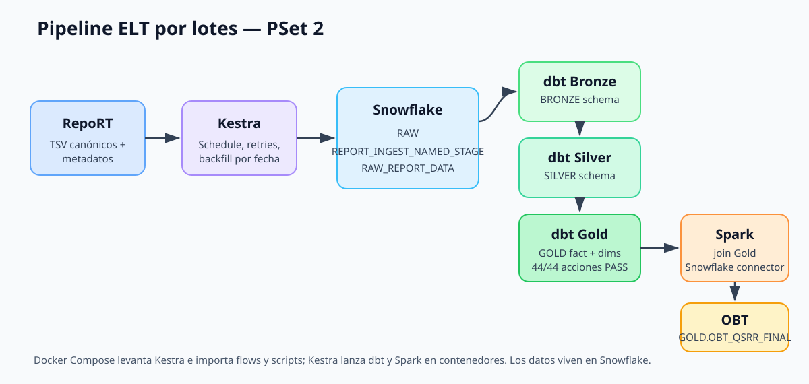
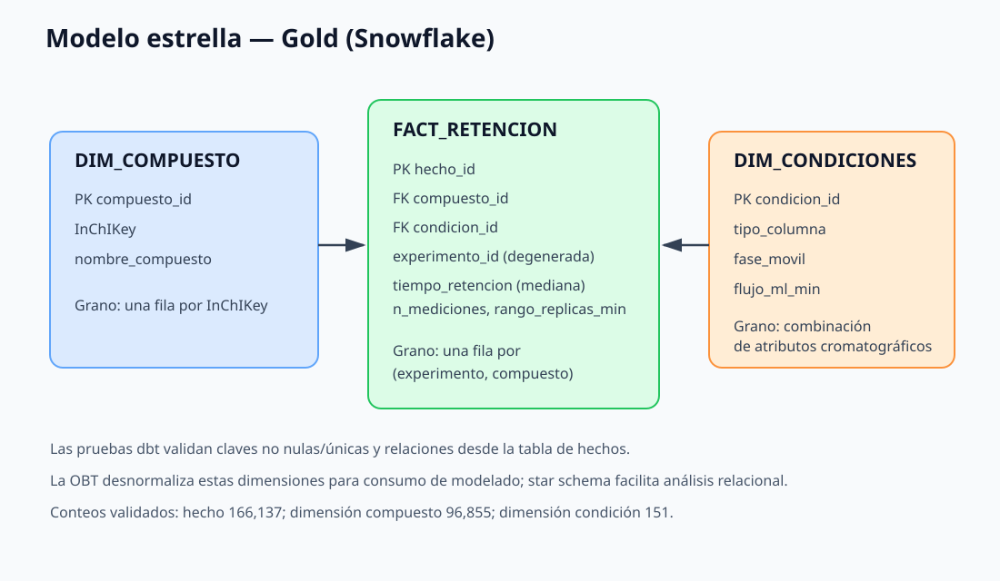

# PSET2
# Pipeline de datos end-to-end

**Proyecto:** datos RepoRT para preparar un conjunto de modelado de retención
cromatográfica.  
**Destino analítico:** `REPORT_QSRR_DB` en Snowflake.  
**Grano objetivo:** una observación de retención por `(experimento, compuesto)`.

## 1. Arquitectura implementada

Para este proyecto elegí RepoRT como fuente porque publica mediciones
cromatográficas y sus condiciones experimentales. El flujo empieza en Kestra:
el extractor reúne los archivos de datos y sus metadatos, y carga una
instantánea en `RAW.RAW_REPORT_DATA`, en Snowflake. A partir de ahí, dbt prepara
las capas `BRONZE`, `SILVER` y `GOLD`. Por último, Spark combina la tabla de
hechos con sus dimensiones y deja el resultado en `GOLD.OBT_QSRR_FINAL`.

Docker Compose construye las imágenes de dbt y Spark, levanta Kestra y, con el
servicio `kestra-deploy`, importa automáticamente los dos flows y sus archivos
de namespace (script de ingesta, proyecto dbt y job Spark). Kestra orquesta todo
el pipeline: después de la carga lanza `dbt build` y `spark-submit` en esos
contenedores. El código vive en el repositorio y los datos en Snowflake.

## 2. Ingesta con Kestra

La fuente es `michaelwitting/RepoRT`. El flujo toma como referencia inicial la
rama `master`, localiza los archivos `*_rtdata_canonical_success.tsv` y
descarga también los metadatos de cada experimento. Luego combina esa
información en un CSV con las mediciones, los identificadores químicos y las
características de la columna y la fase móvil.

Cada ejecución tiene una fecha lógica (`snapshot_date`: el input, la fecha del
trigger o la de inicio). El extractor la resuelve al último commit de RepoRT
hasta ese día, así que la carga queda ligada a un SHA inmutable. Kestra sube el
CSV al stage, lo copia a una tabla transient de la ejecución y, en una sola
transacción, reemplaza **solo la partición** `SNAPSHOT_DATE` de esa fecha en
`RAW_REPORT_DATA`, con `SOURCE_COMMIT`, `EXECUTION_ID` e `INGESTED_AT` como
linaje. Repetir una fecha no duplica filas y las demás fechas se conservan.

**Backfill histórico.** El flow `backfill_report_history` recorre un rango de
fechas (semanal, mensual o trimestral) y ejecuta la ingesta como subflow para
cada una, en orden. Reconstruye lo que RepoRT publicaba en cada período en vez
de volver a leer la versión vigente. En la prueba cargó 2025-01-01 (commit
`95c1f3d`, 183,638 filas) y 2025-04-01 (`bea0c57`, 183,638) junto al snapshot
actual (`420b550`, 183,199). Esa prueba también mostró un cambio de esquema:
en 2024 un experimento no publicaba `column.t0`, que ahora se carga como nulo
en vez de abortar. Las cargas históricas no reconstruyen Gold; Gold usa el
snapshot más reciente (o el indicado con la variable dbt `snapshot_date`).

**Errores y reintentos.** El trigger corre los lunes a las 02:00 UTC; cada paso
de red o de Snowflake reintenta hasta tres veces. Si una tarea falla, el bloque
`errors` registra la tarea y el snapshot afectados (`errorLogs()`), borra la
tabla transient y los archivos del stage de esa ejecución. Como la partición se
publica en una transacción, un fallo nunca deja Raw a medias. Esto se verificó
con un fallo real de dbt durante el desarrollo.

## 3. Calidad y limpieza

Perfilé el snapshot actual (183,199 filas, 420 experimentos). Cada anomalía
termina en una regla aplicada en Silver, y cada fila excluida queda registrada
con su motivo en `SILVER.INT_REGISTROS_CLASIFICADOS`:

| Diagnóstico | Evidencia medida | Decisión de limpieza |
|---|---:|---|
| RT no positivo | 1 fila | Excluir (`rt_no_positivo`). |
| RT ≤ tiempo muerto t0 | 3,912 filas en 151 experimentos (solo 20 bajo 0.5·t0) | Excluir (`no_retenido_rt_menor_igual_t0`): el compuesto no fue retenido y no aporta información estructural para QSRR. |
| t0 = 0 | 14,389 filas | RepoRT usa 0 para "no reportado": se trata como nulo y no se aplica la regla anterior. |
| RT extremo | p99 = 21.9 min, máx. = 100.5 min | Se conservan: los valores altos corresponden a gradientes largos (en el exp. 0039 la mediana es 62.7 min). Tope físico de 120 min con prueba dbt. |
| Compuestos repetidos | 8,279 pares (experimento, InChIKey) con 20,498 filas; rango mediano de 0.06 min, p95 de 1.6 min | Rango ≤ 0.5 min: réplicas, se colapsan en su **mediana** (6,197 pares). Rango > 0.5 min: ambiguas, se excluyen (`replicas_inconsistentes`, 5,117 filas). |
| Unidades de flujo | 0.01–1.5 mL/min; 12,177 nulos | Todo es coherente con mL/min. Un valor > 5 se interpretaría como µL/min y se dividiría entre 1000 (0 casos); los nulos se mantienen como nulos. |
| Nombre / columna ausentes | 49.5 % sin nombre; 1.4 % sin columna | Atributos descriptivos: se conservan nulos, no se inventan. |
| Precisión analítica | Sin referencia externa | Limitación declarada, no validada. |

En total se excluye el **4.9 %** de las filas (9,030) y Silver queda con
**166,137 observaciones**. Los umbrales son variables de `dbt_project.yml`.

## 4. Transformaciones y modelo dimensional

Bronze (`STG_REPORT_DATA`) elige un snapshot de Raw con `source()` y solo
estandariza nombres y tipos, sin descartar filas. Silver tiene dos modelos: uno
clasifica cada fila con las reglas anteriores y otro deduplica a una fila por
`(experimento, compuesto)`. En Gold, `FACT_RETENCION_CROMATOGRAFICA` tiene ese
grano, con `experimento_id` como dimensión degenerada, el tiempo de retención
(mediana), `n_mediciones` y `rango_replicas_min`. Eliminé `factor_retencion`:
RepoRT no lo publica y una columna siempre nula no aporta al modelo.
`DIM_COMPUESTO` tiene una fila por InChIKey y `DIM_CONDICIONES` una por
combinación de columna, fase móvil y flujo.

Además de `not_null`, `unique` y `relationships`, añadí pruebas de dominio. Un
test genérico `en_rango` cubre RT en (0, 120], flujo en (0, 5] y rango de
réplicas ≤ 0.5 min. Hay tests de **conservación de filas** (Bronze = filas
auditadas; filas conservadas = Σ `n_mediciones` de Silver; Silver = hechos;
Bronze = la partición Raw elegida), RT > t0, metadatos constantes por
experimento, motivos de exclusión válidos y un tope del 10 % de exclusiones
contra regresiones. `dbt build` pasó **44 de 44 acciones**. Gold produjo
**166,137 hechos**, **96,855 compuestos** y **151 condiciones**.

## 5. Spark y One Big Table

Una vez disponibles las tablas Gold, Spark 3.5 lee la tabla de hechos y las dos
dimensiones con el conector de Snowflake, integra sus atributos y escribe el
resultado en `GOLD.OBT_QSRR_FINAL`. El grano se mantiene en una fila por
`HECHO_ID`, es decir, una medición canónica.

Antes de unir, el job valida que `COMPUESTO_ID`, `INCHIKEY`, `CONDICION_ID` y
`HECHO_ID` sean únicos y no nulos, y que ningún hecho quede sin dimensión. Ya no
elige una fila por clave: un duplicado es un error del modelo y no debe
ocultarse. Después del join comprueba que la OBT tenga exactamente las filas
del hecho. Si cualquier validación falla, el job termina con código 1
**antes de escribir**: la tarea de Kestra falla y la OBT anterior queda
intacta. Una prueba con una dimensión duplicada y un hecho huérfano confirmó que
se detectan ambos. En la ejecución real: 166,137 hechos = 166,137 filas OBT.

En este proyecto usaría el star schema para consultas analíticas y para
explorar por separado medidas y dimensiones. La OBT me resulta más práctica para
preparar variables de entrada y alimentar un futuro flujo de ciencia de datos,
siempre que se mantenga claro su grano y se compruebe que los joins no alteren
el número de observaciones.

## 6. Batch frente a streaming

Implementé el pipeline por lotes porque RepoRT es un repositorio público que se
actualiza, no una fuente que emite eventos continuamente. Para preparar datos
experimentales, una actualización semanal y una latencia de horas son
suficientes. El enfoque por lotes también permite reconstruir una instantánea
con un SHA de origen y controlar mejor la reproducibilidad y el costo.

Consideraría streaming si el caso de uso empezara a recibir mediciones de forma
continua y necesitara alertas o predicciones en segundos o minutos. En ese
escenario habría que incorporar una fuente de eventos, carga incremental,
checkpoints, procesamiento idempotente y manejo de eventos tardíos. No
implementé streaming porque esos requisitos no existen en el caso actual.

## 7. Limitaciones y reproducibilidad

El alcance comprobado en este PSet es la ingeniería del flujo con datos
públicos de RepoRT. No entrené ni evalué aquí un modelo QSRR con mediciones de
un laboratorio; por tanto, los conteos y pruebas reportados verifican el
pipeline, no la precisión predictiva ni su transferencia a otro laboratorio.

- RepoRT puede cambiar con el tiempo; cada partición de Raw guarda el SHA de
  origen y el backfill reconstruye fechas pasadas a partir del historial de
  commits de RepoRT.
- No comparé la precisión experimental con mediciones externas de referencia.
- RepoRT no publica el factor de retención; la columna se eliminó del modelo.
- Sin acceso a registros de laboratorio, la validación del proyecto se limita a
  RepoRT. El ahorro del 30% en corridas queda como hipótesis por comprobar, no
  como resultado medido ni como ahorro de negocio demostrado.
- Tampoco dispongo de una línea base de consumo por método: faltan el volumen
  de solvente por corrida y el número histórico de corridas preliminares. Esos
  datos permitirían calcular el consumo preliminar como volumen por corrida
  multiplicado por el número de corridas y luego compararlo con el proceso
  actual; no los infiero de RepoRT.
- La generalización a un laboratorio queda pendiente. Si se obtiene acceso,
  habría que acordar con el laboratorio el número de corridas locales de
  control y comparar el RMSE local con el de una evaluación del modelo en
  RepoRT. No asigno un número de corridas sin datos ni un protocolo
  experimental acordado.
- La validación predictiva posterior se limitará a RepoRT para columnas C18,
  sin extrapolar resultados a un laboratorio externo. Esta entrega conserva
  toda la fuente y todavía no filtra a C18; el subconjunto y la evaluación del
  modelo para esa fase quedan pendientes.
- Kestra usa almacenamiento local/H2; `docker compose up` reimporta flows y
  archivos de namespace en cada arranque.
- dbt necesita permisos para crear esquemas y tablas en Snowflake. El conector
  de Spark se descarga al construir la imagen, no en cada ejecución.
- Las tablas quedan en la cuenta Snowflake configurada al ejecutar el pipeline.

El repositorio incluye las instrucciones de ejecución, los diagramas y este
memo. El perfil local de dbt y el archivo `.env` se excluyen del control de
versiones.
