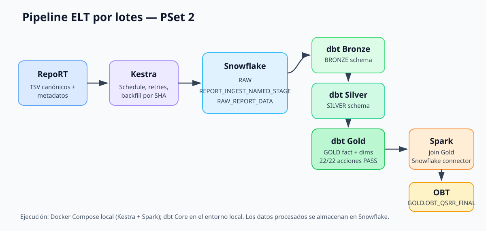
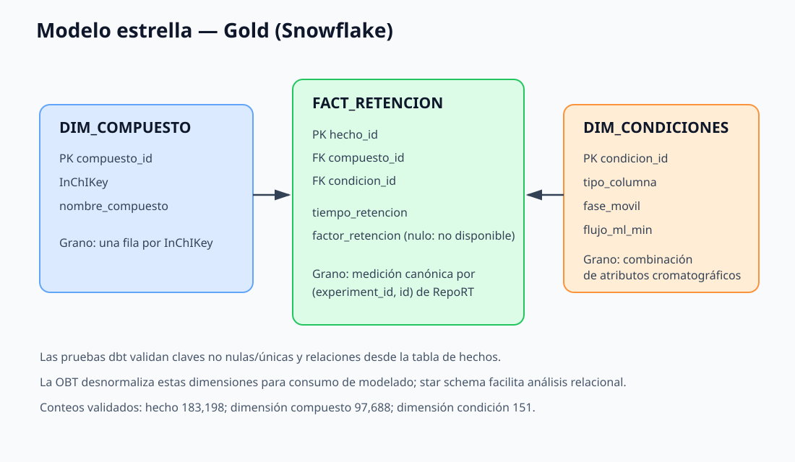

# PSet 2 — Pipeline de datos end-to-end

**Proyecto:** datos RepoRT para preparar un conjunto de modelado de retención
cromatográfica.  
**Destino analítico:** `REPORT_QSRR_DB` en Snowflake.  
**Grano objetivo:** una medición canónica por clave de origen
`(experiment_id, id)`.

## 1. Arquitectura implementada

RepoRT publica archivos TSV de mediciones canónicas exitosas y metadatos de
experimentos. Kestra descarga los archivos, combina mediciones y condiciones,
y carga el snapshot a `RAW.RAW_REPORT_DATA` en Snowflake. dbt construye las
capas `BRONZE`, `SILVER` y `GOLD`; Spark consulta la tabla de hechos y las
dimensiones Gold para materializar `GOLD.OBT_QSRR_FINAL`.

Docker Compose define Kestra y Spark. dbt Core se ejecuta en el entorno local
con un perfil de Snowflake parametrizado mediante variables de entorno. El
código del pipeline es versionable en el repositorio; los datos y tablas
procesados residen en Snowflake. El profesor debe ejecutar el pipeline con sus
propias credenciales, permisos y cuenta, no recibe automáticamente objetos de
otra cuenta Snowflake.

## 2. Ingesta con Kestra

La fuente es `michaelwitting/RepoRT`, rama inicial `master`. El extractor enumera
los archivos `*_rtdata_canonical_success.tsv` de `processed_data/` y descarga
también el archivo de metadata correspondiente. Se genera un CSV que incluye la
identidad del experimento, medición, identificadores químicos y características
de columna/fase móvil.

El flow `pset2.pipeline.ingest_report_to_snowflake` crea si hacen falta el named
stage y el formato CSV, extrae el conjunto, lo sube comprimido, copia a una
tabla transitoria por ejecución y reemplaza `RAW_REPORT_DATA` solo después de
que la carga haya terminado. La carga es un snapshot completo: repetir el flow
no anexa un duplicado del snapshot anterior. La limpieza transitoria ocurre
después de reemplazar Raw.

El trigger está programado cada lunes a las 02:00 UTC. Los pasos de Kestra
reintentan hasta tres veces; las solicitudes HTTP de RepoRT tienen reintentos
adicionales para errores transitorios. `source_ref` admite una rama o un SHA
para repetir una versión histórica y hacer backfill reproducible. Para una
repetición exacta se debe guardar el SHA utilizado, porque `master` es mutable.
En la instantánea ejecutada, Kestra cargó **183,199 filas** en Raw.

## 3. Calidad y limpieza

Las métricas fueron calculadas sobre `RAW_REPORT_DATA` en Snowflake:

| Dimensión / regla | Evidencia medida | Tratamiento |
|---|---:|---|
| Unicidad de origen `(experiment_id, id)` | 0 filas excedentes | Se conserva la clave como `registro_id`; dbt valida `unique` y `not_null`. |
| Completitud de RT | 0 RT nulos; 1 RT no positivo | Bronze conserva valores numéricos válidos; Silver excluye el único RT no positivo. |
| Completitud química | 0 InChIKey nulos | Se conserva InChIKey para construir la dimensión de compuesto. |
| Nombre del compuesto | 90,640 vacíos de 183,199 (49.5%) | No se imputan nombres no provistos por la fuente. |
| Nombre de columna | 2,603 vacíos (1.4%) | Se preserva la medición; atributos descriptivos quedan nulos. |
| Flujo | 12,177 ausentes o no positivos (6.6%) | No se inventan caudales; condiciones se identifican con claves que distinguen valores ausentes. |
| Precisión analítica | Sin medición externa de referencia | Se usan los registros marcados canónicos exitosos por RepoRT; la exactitud experimental no se afirma como validada independientemente. |

Bronze estandariza nombres, deriva la clave de origen y convierte RT a número.
Silver conserva una fila por `registro_id` y filtra únicamente `tiempo_retencion
> 0`; no deduplica por compuesto/columna, porque eso eliminaría mediciones
distintas. Resultado: **183,198 filas Silver**. Los valores ausentes de metadata
se conservan explícitamente en vez de eliminar observaciones.

## 4. Transformaciones y modelo dimensional

`BRONZE.STG_REPORT_DATA` enlaza Raw mediante `source()`. El modelo
`SILVER.INT_RETENCION_FILTRADA` utiliza `ref()` a Bronze y aplica la regla
física de RT positivo. dbt declara la fuente y el grafo de dependencias; los
modelos se materializan en esquemas Snowflake separados.

Gold implementa un star schema. El grano de
`GOLD.FACT_RETENCION_CROMATOGRAFICA` es una medición canónica de RepoRT por
`(experiment_id, id)`. Sus medidas son tiempo de retención y factor de
retención; RepoRT no publica un factor de retención, por lo que queda nulo y no
se fabrica. `DIM_COMPUESTO` tiene una fila por InChIKey. `DIM_CONDICIONES` tiene
una fila por combinación de tipo de columna, fase móvil y flujo; los atributos
ausentes forman una condición identificable y no generan claves nulas.

Las pruebas dbt validan claves `not_null` y `unique`, así como las relaciones de
la tabla de hechos con las dos dimensiones (`relationships`). La ejecución
validada pasó **22/22 acciones**. Conteos: hecho **183,198**, dimensión de
compuesto **97,688**, dimensión de condiciones **151**.

## 5. Spark y One Big Table

Spark 3.5 lee Gold mediante el conector Snowflake, ejecuta la integración con
las dimensiones y escribe `GOLD.OBT_QSRR_FINAL`. El grano es una fila por
`HECHO_ID`, equivalente a una medición canónica de Silver. Se usa una
representación determinista de cada dimensión y joins que mantienen todos los
hechos, aun cuando falten atributos descriptivos. Las pruebas de relaciones
dbt aseguran que las claves sí estén presentes en las dimensiones.

Validación Snowflake posterior: OBT **183,198 filas**, **183,198 `HECHO_ID`
distintos**, cero IDs nulos. Los 2,603 casos sin metadata de columna permanecen
en la OBT con atributos de condición nulos; no se convierten en hechos
duplicados ni se descartan.

Usaría el star schema para análisis SQL, agregaciones y exploración modular de
medidas y dimensiones. Usaría la OBT como una tabla conveniente para preparar
features y alimentar un futuro flujo de ciencia de datos, aceptando el costo de
redundancia y manteniendo el control de su grano.

## 6. Batch frente a streaming

El proceso es batch porque la fuente es un repositorio público versionado, no
un flujo de eventos con requisito de reacción inmediata. La actualización
semanal y el tiempo de latencia de horas son suficientes para el uso actual de
preparación de datasets experimentales. El batch permite rehacer un snapshot
histórico con el SHA fuente y controlar costo y reproducibilidad.

Consideraría streaming solo si el caso de uso recibiera mediciones
cromatográficas nuevas continuamente y el negocio necesitara alertas o
predicciones en segundos/minutos. Eso requeriría una fuente de eventos, captura
incremental, checkpoints, procesamiento idempotente, gestión de eventos tardíos
y SLAs de baja latencia. No se implementa streaming en este PSet.

## 7. Limitaciones y reproducibilidad

- RepoRT es mutable; guardar y entregar el SHA de `source_ref` es necesario para
  reproducir exactamente una extracción.
- Los datos tienen faltantes importantes en nombres y metadata de columna.
  No se imputan porque la fuente no aporta valores de reemplazo.
- La precisión experimental no se contrastó con una referencia externa.
- El factor de retención no está publicado por esta fuente y permanece nulo.
- Kestra usa una configuración local/H2; el flow y su archivo Python deben
  importarse en el namespace del entorno de ejecución.
- dbt requiere que el rol Snowflake pueda crear esquemas y tablas; Spark requiere
  acceso de red a Maven Central la primera vez.
- Las tablas son propiedad de la cuenta Snowflake configurada al ejecutar.
  Para que un profesor reproduzca el trabajo en su cuenta debe proporcionar sus
  propias credenciales y permisos; no se deben entregar secretos.

El repositorio incluye instrucciones en `README.md`, resumen en `README1.md`,
diagramas SVG y este memo. El perfil de dbt y `.env` con credenciales están
excluidos de Git.
